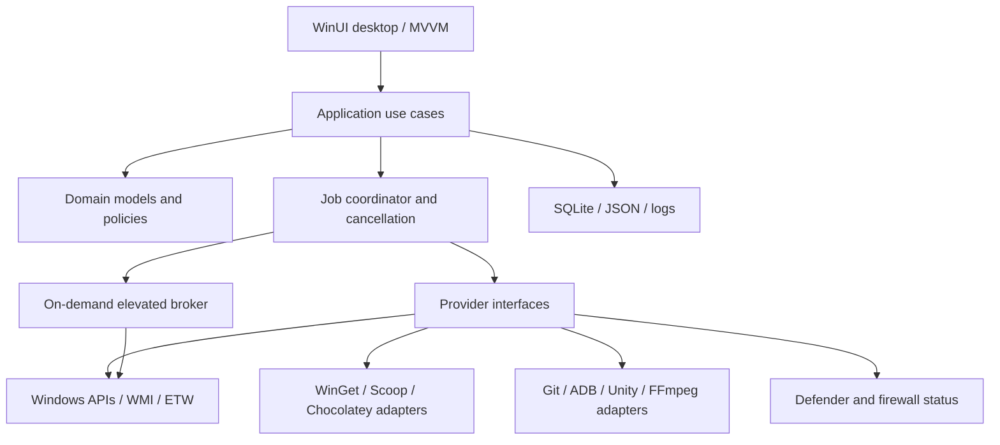

# Architecture — Veltrivon v0.1

## Implemented components

- **Veltrivon desktop** uses .NET 10 and WinUI 3 for catalog browsing, selected WinGet installations, app launching, and read-only diagnostics. The catalog is an embedded copy of `installer/catalog.json`.
- **Utility installer** offers workstation, developer, and XR profiles through the Windows batch entry point or standalone Go executable. The Go executable embeds the catalog. Batch package rows mirror its exact WinGet IDs. Each catalog record carries a primary profile and optional additional memberships, so installing all profiles processes shared tools once.
- **XR Dev Manager** is a separate MIT-licensed .NET 10 CLI. It invokes ADB and scrcpy for headset operations, reads the Windows OpenXR registration, and starts an explicitly selected PC VR launcher. ALVR provides streaming and is available through the catalog's manual setup links.

Developer and XR profiles favor open-source upstream tools. The installer resolves package identities and displays publisher links for packages that need separate setup. Dependency installation and device operations run as the current user, with elevation requested by individual installers when required.

## Planned workstation architecture

The diagram describes the target architecture for expanded diagnostics, persistence, package providers, and elevated operations. Windows 11 x64 is the initial desktop target.

## Boundaries
- `Veltrivon.App`: navigation, settings, accessibility, views and view models; unelevated.
- `Veltrivon.Core`: immutable findings, action plans, risk levels, typed module contracts; no Windows dependencies.
- `Veltrivon.Application`: scan orchestration, permissions, action approval and audit.
- `Veltrivon.Windows`: signed Windows provider adapters, structured queries, command runners with argument lists, timeouts and exit codes.
- `Veltrivon.Broker`: on-demand administrator process, authenticated per-user IPC; validate allowlisted operation IDs and typed arguments; no arbitrary shell execution.
- `Veltrivon.Infrastructure`: local SQLite repository, migrations, logs, redaction, settings and export.
- `Veltrivon.Modules.*`: built-in feature packages; optional signed plugins later, isolated out-of-process when appropriate.
- `installer`: independent, embedded manifest CLI installer with WinGet source and exact-ID search.

## Operation flow
Discover -> scan -> finding -> proposed action -> preview/impact -> consent -> privilege check -> execute -> verify -> audit -> rollback where supported. Read-only scan by default. Revalidate stale plans immediately before writes. Every operation supports cancellation when the underlying tool does; do not terminate DISM or updates blindly. Store errors, exit codes, duration and redacted output. Reboots require explicit approval.

## Provider contracts
`IScanner.ScanAsync(context, cancellationToken)` returns findings. `IActionProvider.PlanAsync(finding)` returns typed action plan with targets, risk, privileges, dependencies, expected effect and reversibility. `ExecuteAsync(approvedPlan)` returns a structured result. `VerifyAsync` checks postconditions; `RollbackAsync` is optional and must not promise reversibility for arbitrary operations. `IPackageProvider` exposes search, inventory, install and update using exact identities. `ITelemetryProvider` streams bounded samples. `IReportStore` saves redacted local history.

## Safety and security
Protect Unity Library, SDKs, Gradle, Git, NuGet, user documents and downloads from default cleanup; never recursively follow junctions/reparse points. No generic registry cleaner, disabling security features, RAM purges, silent driver updates, automatic startup changes, or unsupported antivirus claims. Use Defender/Windows Security APIs and supported commands. No credential capture, no default cloud telemetry. Respect permissions, validate paths, use least privilege, sign releases, publish SHA-256/SBOM; check dependency licenses (especially GPL) before redistribution or linking. Restore points are optional and not guaranteed to undo file deletion. Use a reviewable quarantine for eligible files. Do not run two antivirus engines. Hardware stress tests require explicit confirmation and thermal stop thresholds.
